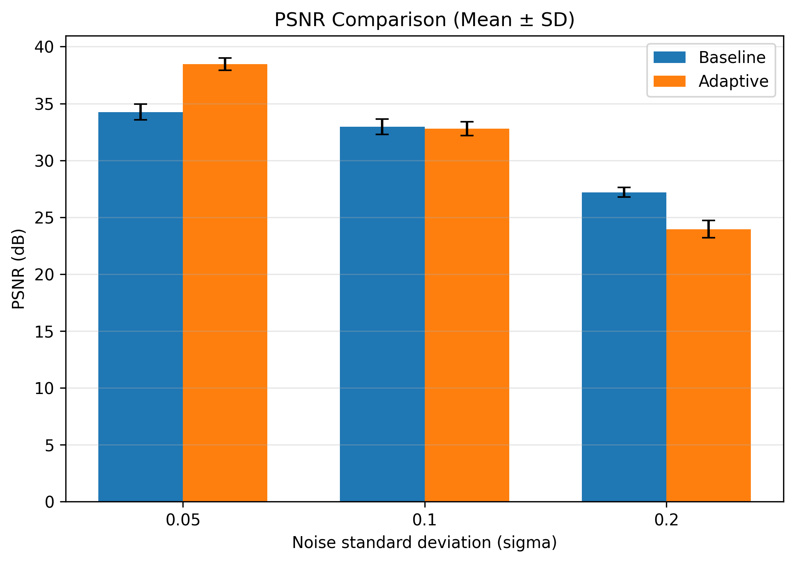
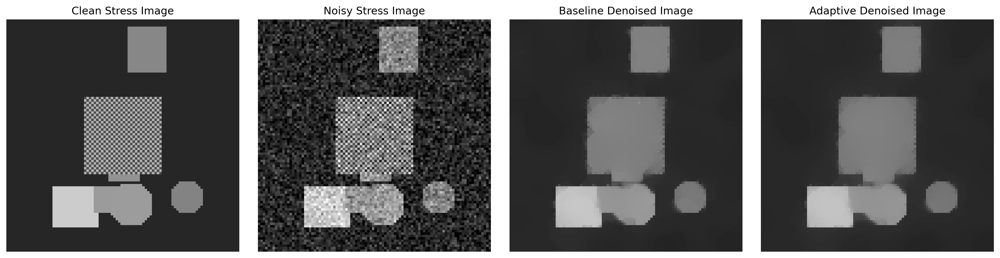
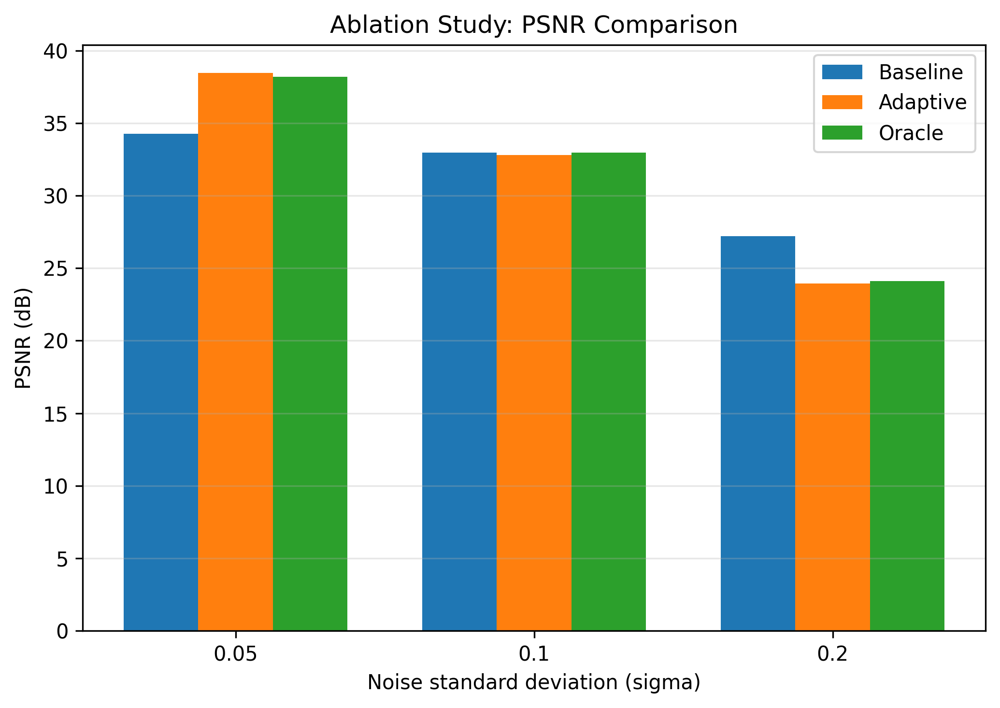

# Qianyao_Project_55C36
Image processing

# Imageprocessing: total-variationdenoising

## 1. Project Overview

- Module: EEP55C36 Computational Methods and Algorithms
- Research Track: I - Image Processing
- Author: Qianyao Xu
- Institution: Trinity College Dublin

This project implements Chambolle's total variation (TV) denoising algorithm for grayscale images and investigates a noise-adaptive regularisation method.

The baseline uses a fixed regularisation parameter, while the modified method estimates the noise level from the noisy image and adjusts the regularisation parameter accordingly.

The aim is to investigate whether adaptive regularisation can improve denoising performance under different noise conditions.

## 2. Repository Structure

| File / Folder | Description |
|---|---|
| `src/data.py` | Synthetic image and noise generation |
| `src/operators.py` | Gradient and divergence operators |
| `src/baseline.py` | Baseline TV denoising |
| `src/modified.py` | Noise-adaptive TV denoising |
| `src/metrics.py` | Evaluation metrics |
| `src/test.py` | Numerical and algorithm verification |
| `configs/` | Experiment configurations |
| `run_experiments.py` | Main comparison experiments |
| `stress_test.py` | Stress test |
| `ablation_study.py` | Ablation study |
| `plot_results.py` | Result visualization |
| `results/` | Experimental data and figures |

## 3. Environment and Installation

Tested on Windows with Python 3.9.7, NumPy 1.26.4 and Matplotlib 3.5.0.

To set up the project, run the following commands:

```bash
git clone https://github.com/x7y0828/Qianyao_Project_55C36.git
cd Qianyao_Project_55C36
git checkout v1.0-submission
python -m venv .venv
.\.venv\Scripts\Activate.ps1
python -m pip install -r requirements.txt
```

No GPU or external dataset is required.

## 4. How to Run

### Correctness Checks
```bash
python -m src.test
```

### Smoke Test
```bash
python run_experiments.py --config configs/smoke.json
```
Runs six paired cases to verify the experimental pipeline.
Results are saved in `results/smoke/`.

### Full Experiment
```bash
python run_experiments.py --config configs/final.json
```
Runs 60 paired cases and generates:
- `results/raw_results.csv`
- `results/summary_results.csv`

### Stress Test
```bash
python stress_test.py
```
Generates `stress_results.csv` and `stress_test.png`.

### Ablation Study
```bash
python ablation_study.py
```
Compares the baseline, adaptive method and oracle variant.
Results are saved in `ablation_results.csv`.

### Result Visualization
```bash
python plot_results.py
```
Generates the performance comparison and ablation figures from the saved CSV files.

All commands should be executed from the repository root directory.

## 5. Experimental Settings

Synthetic grayscale images with geometric structures and additive Gaussian noise are used for evaluation.

Development, validation and final-test cases are separated. Both methods receive the same noisy input for each paired experiment.

| Parameter | Value |
|---|---|
| Image size | 96 x 96 |
| Noise levels | 0.05, 0.1, 0.2 |
| Final-test seeds | 200-219 |
| Cases per noise level | 20 |
| Total paired cases | 60 |
| Baseline lambda | 0.15 |
| Adaptive alpha | 15.0 |
| Maximum iterations | 200 |
| Runtime warm-up | 1 |
| Runtime repetitions | 5 |

The evaluation metrics include MSE, PSNR, Gradient MSE and runtime.

Mean, standard deviation, paired improvement, 95% confidence intervals and adaptive win rates are calculated for each noise level.

The experiment settings are stored in `configs/final.json`. Runtime may vary between executions and hardware platforms.

## 6. Results and Limitations

### Performance Comparison
| Noise level | Baseline PSNR (dB) | Adaptive PSNR (dB) |
|---|---:|---:|
| 0.05 | 34.254 | 38.469 |
| 0.10 | 32.960 | 32.788 |
| 0.20 | 27.198 | 23.958 |



The adaptive method improves denoising performance at low noise levels but performs worse at high noise levels. The runtime difference between the two methods is small.

### Stress Test



Both methods remove noise but tend to oversmooth high-frequency textures.

### Ablation Study



The oracle variant uses the known synthetic noise level instead of the estimated noise level.

The results suggest that noise estimation error is not the only reason for the poor performance at high noise levels. The adaptive regularisation rule may also contribute to this limitation.

### Limitations

- Only synthetic grayscale images and Gaussian noise are considered.
- The adaptive method does not consistently outperform the baseline.
- TV denoising may remove fine image textures.
- The adaptive method is sensitive to regularisation parameter selection.

## 7. References

[1] A. Chambolle, "An Algorithm for Total Variation Minimization and Applications," Journal of Mathematical Imaging and Vision, vol. 20, pp. 89-97, 2004.

https://doi.org/10.1023/B:JMIV.0000011325.36760.1e

[2] EEP55C36 Computational Methods and Algorithms, Final Project Brief and Research Project Topics, Trinity College Dublin.

## 8. Assistance Declaration

ChatGPT was used as a supplementary tool for mathematical clarification, implementation guidance and debugging. The author conducted the experiments, verified the implementation and evaluated the results.
